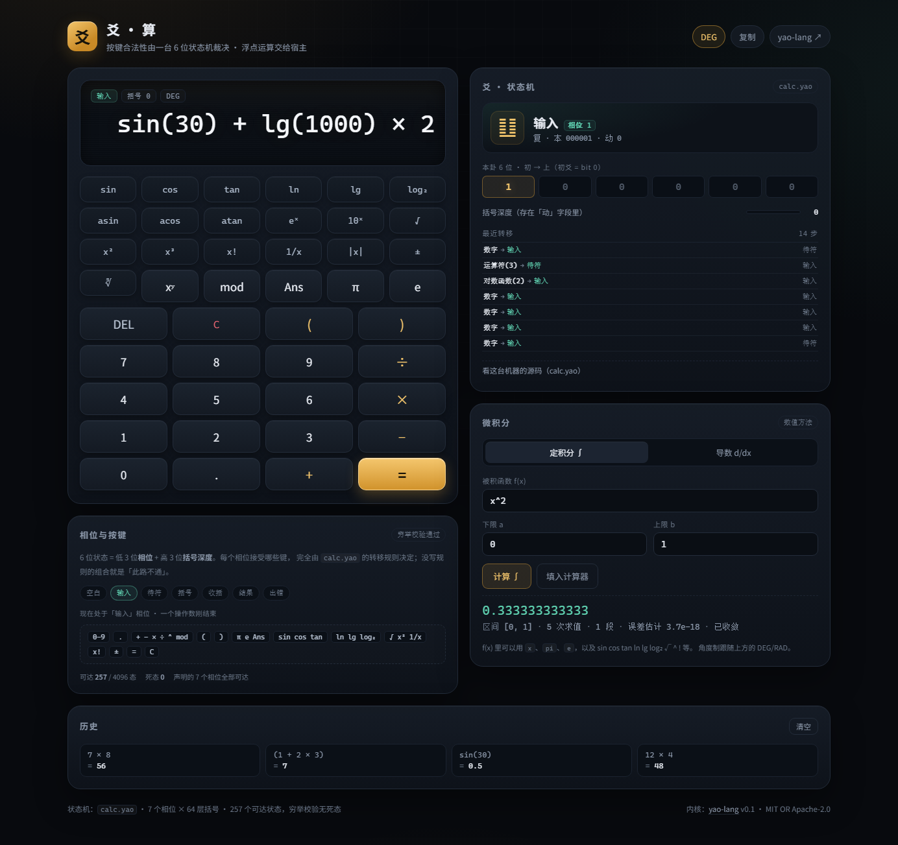

# 爻 · 算

**用 [yao-lang](https://github.com/MaverickChou/yao-lang) 写的一台科学计算器。**

打开 **`docs/index.html`** 就能用（单文件、离线、无依赖）。
按键能不能按、按完进入什么状态、括号还剩几层，由一份 `calc.yao` 状态机裁决；
浮点数、函数、微积分交给宿主 JS —— 这正是 yao 的 SPEC 定下的分工。

上游语言内核以 **git submodule** 固定在 `vendor/yao-lang`，本仓库只放计算器这一层。



---

## 为什么这样分工

yao 是一门**把状态机编译成 C99 的 6 位语言**。它明确不管字符串、堆分配、浮点，
只管「状态与转移」。计算器恰好是个反例：数值必须用浮点，按键序列却是标准的状态机。
所以这里把两者拆开：

| 层 | 语言 | 负责 |
|---|---|---|
| 状态机 | `calc.yao`（爻） | 相位、括号深度、按键合法性 |
| 表达式 | `app/expr.js`（JS） | 词法、文法、优先级、函数、求值 |
| 数值 | `app/calculus.js`（JS） | 自适应 Simpson、四点差分 + Richardson |

宿主从不自己判断「这个键能不能按」：每次按键都先 `machine.step(event, arg)`，
被拒绝就只响一声、抖一下，表达式一个字都不改。

### 6 位状态怎么装下「相位 + 括号深度」

`变` 是 12 位：低 6 位 `本`、高 6 位 `动`。转移只按 `本` 匹配，于是：

```yao
state = 变(相位, 括号深度)

转 输入 左括号 -> 若 动(变) < 63 { 变(括号, 动(变) + 1) } 否则 { 变(出错, 0) }
转 输入 右括号 -> 若 动(变) > 0  { 变(收括, 动(变) - 1) } 否则 { 变(出错, 0) }
```

7 个相位 × 64 层括号 = 448 种组合，却只需要 **7 组规则**，因为匹配只看 `本`。
这是上游 `examples/traffic` 把秒数塞进高 3 位的同一种手法；区别是这里借用了 `动`
当深度字段，因此 `变数(变)` 在本 demo 里没有意义 —— 这是有意的取舍，换来 448 个
组合不写 448 条规则。

### 7 个相位

| 相位 | 含义 | 典型出口 |
|---|---|---|
| 空白 | 刚清空 | 数字 / 小数点 / `(` / 常数 |
| 输入 | 一个操作数刚结束 | 运算符 / 函数 / `)` / `=` |
| 待符 | 刚按了二元运算符 | 数字 / 常数 / 换一个运算符 |
| 括号 | 刚按 `(` | 数字 / 常数 / `(` |
| 收括 | 一个括号组刚闭合 | 运算符 / `)` / 函数 / `=` |
| 结果 | 等号算完 | 运算符（接着算）/ 数字（重来）/ 函数 |
| 出错 | 求值失败或括号不配 | `C` / 数字（重来） |

`calc.yao` 里**没有规则**的组合就是「此路不通」。所以 `yao check` 报的
「未定义转移 33 / 98」不是缺陷，而是设计：这 33 个组合正是被拒绝的按键。

```
$ node vendor/yao-lang/bin/yao.js check calc.yao
  声明态      7
  可达态      257 / 4096
  态可达      7 / 7
  死态        0
  未定义转移  33 / 98（态 × 事件）
  强连通      是（1 个分量，257 个状态）
  ✓ 没有发现问题
```

---

## 功能

**四则与优先级**：`+ − × ÷ ( )`、`^` 幂、`mod` 取余、`!` 阶乘、`±` 取负、`1/x`、`x²`、`x³`

**对数与指数**：`ln`、`lg`（log₁₀）、`log₂`、`eˣ`、`10ˣ`；
表达式层还支持 `log(x)`（以 10 为底）与 `log(x, b)`（任意底）

**三角**：`sin cos tan asin acos atan sinh`，角度制 / 弧度制一键切换（DEG / RAD）

**微积分**：

- 定积分 `∫ₐᵇ f(x) dx` —— 自适应 Simpson，实时显示求值次数、分段数、误差估计与是否收敛
- 导数 `f′(x₀)` —— 四点差分 + Richardson 外推，同样报告步长与收敛性
- `f(x)` 里可以写 `x`、`pi`、`e`，以及上面所有函数；上下限本身也可以是表达式（如 `pi/2`）

**其他**：`π`、`e`、`Ans` 常量，`√`、`∛`、`|x|`、取整、历史记录一键取回、
复制完整精度、键盘输入、括号未闭合时按 `=` 自动补齐（并在屏幕上用幽灵 `)` 预告）。

---

## 怎么用

双击 `docs/index.html`。没有服务器、没有 npm install、没有 WASM。
（仓库开启 GitHub Pages 后也可以直接从 `/docs` 发布。）

键盘：`0-9 . + - * / ^ % ( )`、`Enter` 或 `=` 求值、`Backspace` 退格、`Esc` 清空，
`p` 插入 π、`e` 插入 e、`s`/`c`/`t` 分别调 sin/cos/tan。

### 几个设计上的小约定

- **函数作用在紧邻的操作数上**：先按 `30` 再按 `sin`，得到 `sin(30)`。
  在结果相位上按函数，会立刻把函数作用在结果上（像卡片计算器）。
- **一键换运算符**：`1 + ` 之后按 `×` 会直接替换成 `1 × `。
- **隐式乘法**：`2 × (3)` 里的乘号由宿主补上，`2π`、`2(3+4)` 都能算。
- **结果接着算**：`=` 之后再按运算符，会拿上一次的结果继续（`Ans` 语义）。
- **出错可恢复**：除以 0、`ln(-1)`、括号不配都会进入「出错」相位，按数字或 `C` 重来。

---

## 开发

```bash
git clone --recursive <this-repo>          # 或者 clone 之后：
git submodule update --init --recursive

node build.mjs                             # 重新生成 docs/index.html
npm test                                   # 44 个测试（= node --test tests/*.test.mjs）
node vendor/yao-lang/bin/yao.js check calc.yao
node scripts/browser-check.mjs             # 真 Chrome 冒烟 + 截图（25 项，需 Node ≥ 22）
```

CI（`.github/workflows/ci.yml`）跑三件事：单测、构建、以及
**构建产物与提交的 `docs/index.html` 是否一致**（`git diff --exit-code`）。

`scripts/browser-check.mjs` 用 Chrome DevTools Protocol 直接操作页面：
按真实按钮、敲键盘、读 DOM、检查脚本异常、截图到 `shots/`。不依赖 Playwright。
它用了全局 `WebSocket`（Node ≥ 22），所以只作为本地脚本，不进 CI。

### 文件

```
docs/index.html          构建产物：单文件，双击即开（也是 Pages 入口）
calc.yao                 状态机本体（本项目的核心）
app/expr.js              表达式：词法 / 文法 / 求值 / 数字格式化
app/calculus.js          数值积分与数值微分
app/engine.js            按键 → 状态机 → 表达式缓冲
app/ui.js / style.css / template.html   界面
build.mjs                把内核 + 应用 + 页面打包成一个 HTML
scripts/browser-check.mjs 浏览器自动化检查
tests/                   44 个测试（表达式 / 微积分 / 状态机 / 引擎）
vendor/yao-lang/         上游内核（git submodule）
```

`build.mjs` 和上游的 `tools/build_web.mjs` 用同一套办法：语言内核是纯 ESM，
唯一的 Node 依赖是 `core.js` 里读 `hexagrams.json` 的那一句，打包时换成内联数据。
替换点找不到就直接报错，不产出「只能在 Node 跑」的坏包。

### 状态机也能单独跑

```bash
node vendor/yao-lang/bin/yao.js trace calc.yao 数字 数字 运算符 数字 等号
node vendor/yao-lang/bin/yao.js build calc.yao --main -o calc.c   # 需要 C 编译器
```

---

## 上游与同步

上游：[`MaverickChou/yao-lang`](https://github.com/MaverickChou/yao-lang)（MIT OR Apache-2.0）。

- 内核以 submodule 固定在 `vendor/yao-lang`，记录在 `.gitmodules` 与 gitlink 里；
- 拉取上游新提交：

  ```bash
  git submodule update --remote vendor/yao-lang
  npm test && node build.mjs
  git add vendor/yao-lang docs/index.html && git commit -m "chore: 同步 yao-lang"
  ```

- 内核一旦改动，`docs/index.html` 会变，CI 的产物一致性检查会替你抓住这一点。

## 测试覆盖

| 文件 | 内容 |
|---|---|
| `tests/expr.test.mjs` | 优先级、隐式乘法、对数、三角、定义域、错误文案、格式化 |
| `tests/calculus.test.mjs` | ∫x²、∫sin、∫eˣ、∫1/x、换限、发散检测；sin′、x²′、ln′、二阶导 |
| `tests/machine.test.mjs` | 合法/非法转移、括号深度、63 层封顶、清空、穷举校验无死态 |
| `tests/engine.test.mjs` | 真实按键序列、自动补括号、退格、出错恢复、Ans、历史、12 位布局 |

浏览器检查覆盖：页面加载、44 个按键、`12 × 4 = 48`、DEG 下 `sin 30 = 0.5`、
非法按键被拒、括号预览与自动补齐、积分/导数面板、历史取回、填入计算器、
物理键盘（`7 * 8 Enter = 56`）、相位面板、零脚本异常。

---

## 边界

- 只做实数：`√(-1)`、`ln(0)`、负数非整数次幂都报「不在实数范围内」。
- 微积分是**数值**的：不光滑点（如 `|x|` 在 0）可能不收敛；被积函数在区间内发散会直接报错。
- 括号深度封顶 63 层（`动` 只有 6 位）。
- 6 位状态里没有寄存器：操作数、表达式都在宿主。这是 yao 的定位，不是妥协。
- 界面没有复数、矩阵、符号求导、单位换算。

## 许可

本仓库采用 **MIT OR Apache-2.0**，与上游一致，见 [LICENSE-MIT](LICENSE-MIT) 与
[LICENSE-APACHE](LICENSE-APACHE)。`vendor/yao-lang` 是上游代码，版权归其 contributors；
`data/hexagrams.json` 等数据同样来自上游。
